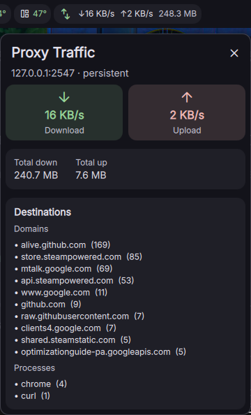
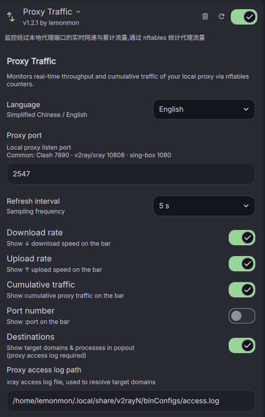

# Proxy Traffic — DMS Plugin

**[简体中文](README_zh-CN.md) · English**

A [DankMaterialShell](https://github.com/AvengeMedia/DankMaterialShell) bar widget that monitors the real-time throughput and cumulative traffic of your local proxy via **nftables** counters.

## Features

- **Bar pill** — live proxy download/upload speed (`↓1.2 MB/s ↑45 KB/s`)
- **Popout panel** — click the pill for a set of cards: live rates, cumulative traffic, history, destinations, redirect
- **Modular popout cards** — each card (speed / cumulative / history / destinations / redirect) can be shown or hidden independently and **reordered** in settings
- **History card** — today's traffic persisted across restarts, with a **per-day line chart** (proxy/direct lines use the theme accent colors) of the last N days (3/7/14/30/90), and a **hover tooltip** on each day showing that day's proxy/direct up & down
- **Today card** — live proxy (`Proxy`) and direct (`Direct`) cumulative totals for today (up+down combined), using the theme accent/success colors
- **Subscription quota (optional)** — with an HTTP(S) subscription URL, the Today card shows used / total from the `subscription-userinfo` header, or remaining / expiry when the provider only puts that information in node names
- **App usage (optional)** — the Destinations card shows today's proxy usage per app; it samples local TCP socket counters via `ss`, keeps closed apps' totals for the day, and is approximate (up to ~2 s of the final traffic can be missed)
- **Persistence** — both cumulative totals and the per-day history survive restarts (persisted to the plugin state), even though nftables counters reset to zero on boot
- **Proxy-only** — only counts traffic flowing through the local proxy port
- **Redirect breakdown (xray)** — optional per-outbound proxy vs direct byte totals (and the cumulative/history chart) read from xray's StatsService (`/debug/vars`)
- **Configurable display**: toggle download rate / upload rate / cumulative traffic / port on the bar
- Adjustable refresh interval (1–5 s)
- Bilingual UI (zh/en)
- Works with horizontal and vertical bars

## Installation

Clone (or copy) this directory into the DMS plugins folder:

```bash
git clone https://github.com/Lemon-mon-254/dms-proxy-traffic.git ~/.config/DankMaterialShell/plugins/ProxyTraffic
```

Then in DMS: **Settings → Plugins → Scan for Plugins**, enable **Proxy Traffic**, add it to your DankBar layout and restart the shell:

```bash
dms restart
```

## Quick start

Run the one-command installer. It installs `nft` if missing, creates the nftables counters for your proxy port, makes them **persistent** across reboots, and grants passwordless read access to just the two counter chains:

```bash
cd ~/.config/DankMaterialShell/plugins/ProxyTraffic
sudo ./setup-nftables.sh install
```

Use `PROXY_PORT` if your proxy listens on a non-default port:

```bash
PROXY_PORT=2547 sudo ./setup-nftables.sh install
```

Common proxy ports: **Clash 7890** · v2ray/xray 10808 · sing-box 1080.

`install` performs the following (each also available individually):
- detects/installs `nft` (`nftables`)
- creates the rule file `/etc/nftables.d/proxy-traffic.nft` for your port
- applies the counters immediately
- enables a systemd service (`nft-proxy-traffic.service`) so counters reload on boot
- writes `/etc/sudoers.d/proxy-nft` with only `nft list chain inet proxy_stat input` and `... output` allowed, so the widget can read counters without prompting but cannot modify the firewall

> **Upgrading from 1.5.0 or earlier:** rerun `sudo ./setup-nftables.sh sudoers` (or `install`) once to replace the old unrestricted sudoers rule.

> **Note:** re-running `install` (or `create`) resets the counters to zero. Set the plugin's *Proxy port* to the same value you used here.

## Configuration

| Setting | Default | Description |
|---|---|---|
| Proxy port | `7890` | Local proxy listen port (must match the port used to create nftables rules; common: Clash `7890` · v2ray/xray `10808` · sing-box `1080`) |
| Refresh interval | `2s` | Sampling frequency |
| Show download rate | on | `↓ speed` on the bar |
| Show upload rate | on | `↑ speed` on the bar |
| Show cumulative | off | Shows total proxy traffic on the bar |
| Show port | off | Appends `:port` |
| Destinations | off | Popout shows target domains, apps & today's usage (domains need proxy access log; app usage is approximate TCP data) |
| Redirect (xray) | off | Popout shows proxy vs direct byte totals per xray outbound |
| **Use xray for cumulative** | off | Cumulative total uses xray (`/debug/vars`) instead of nftables, so it keeps counting across reboots. Only applies on xray/v2rayN |
| **Bar cumulative = proxy only** | off | When the bar shows cumulative traffic, show only the proxy amount. Needs *Use xray for cumulative* |
| **Speed card** | on | Popout card with live down/up speeds |
| **Cumulative card** | on | Popout card with cumulative down/up traffic |
| **History card** | on | Popout card with today's traffic and its line chart |
| Chart days | `7` | How many days of history the line chart shows (3/7/14/30/90) |
| Subscription URL | empty | Optional; shows subscription used / total (or remaining / expiry when only that is available) in the Today card; the URL contains a token, keep it private |
| **Order** | — | Reorder the popout cards (up/down buttons per card) |
| xray API port | `2551` | xray API inbound port, used for the redirect view and xray-backed history |
| xray access log | empty | Optional xray access log used by the Destinations card; leave empty to disable |

> **Important:** the *Proxy port* in settings should match the port used when running `setup-nftables.sh install`, otherwise counters will not match.

> The xray sampler only runs while **Redirect**, **History card**, or **Use xray for cumulative** is enabled.

## Redirect breakdown (xray only, optional)

When enabled, the popout shows how much traffic left through each xray outbound (`proxy` vs `direct`), read from xray's built-in expvar endpoint:

```bash
http://127.0.0.1:<xray-api-port>/debug/vars   # -> .stats.outbound.{proxy,direct}.{downlink,uplink}
```

- Requires xray/v2rayN to have outbound traffic stats enabled (`policy.system.statsOutboundUplink/Downlink`, enabled by default in v2rayN) and an API inbound (default `2551`).
- No nftables rules needed for this view; it supplements (not replaces) the nftables counter.
- If the port is unreachable, the popout shows a *"xray stats unavailable"* hint instead of failing.
- Besides the redirect card, xray also powers the **Today card** and the **history line chart** (proxy vs direct per day). These two always use xray for the proxy/direct split, so for a meaningful chart point the proxy API must be reachable.

## Subscription quota (optional)

After entering an HTTP(S) subscription URL in settings, the widget fetches it every 30 minutes and shows quota information in the **Today** card.

If the provider returns the common v2rayN / Clash header:

```
Used 12.3 GB / 100 GB
```

- Supports the `subscription-userinfo` header (`upload` / `download` / `total` / `expire`, in bytes).
- `total=0` is shown as unlimited.
- The helper identifies itself as a Clash client, because some providers only return `subscription-userinfo` to Clash clients.

Some providers return a base64 node list without that header and put metadata in node names instead, for example:

```
剩余流量：1.25 TB
套餐到期：长期有效
```

In that case the card shows:

```
Subscription remaining 1.25 TB · 长期有效
```

- This nonstandard format only exposes remaining traffic and expiry, not a total; used / total cannot be calculated from it.
- If neither source is available, the card shows "Subscription unavailable".
- The URL contains a token and is only stored in DMS plugin settings; it is not written to logs or plugin state. Keep it private.

## App usage (optional)

When the **Destinations** card is enabled, it shows today's TCP traffic through the proxy for each application. Counting starts when the card is first enabled or the plugin restarts; traffic from before that cannot be recovered.

- Samples local TCP socket counters on each refresh (2 s by default) and accumulates them per app; an app's total remains after it closes.
- TCP only: UDP and direct traffic are not included. Up to ~2 seconds of a connection's final traffic can be missed, so the values are approximate.
- Requires socket process information visible to the user (normally true for apps running as the same user).
- State is stored in `$XDG_STATE_HOME/dms-proxy-traffic/app-usage.json` (default `~/.local/state/dms-proxy-traffic/app-usage.json`) and resets at the local date change.
- Target domains still come from the xray access log; without that log, only app usage is shown.

## Managing rules

```bash
sudo ./setup-nftables.sh show          # inspect current counters & service status
sudo ./setup-nftables.sh create        # re-create/apply counters (resets totals)
sudo ./setup-nftables.sh delete        # remove runtime counters (cumulative reset)
sudo ./setup-nftables.sh uninstall     # remove counters + service (+ optionally sudoers)
```

The counters are **persistent** (a systemd service reloads them on boot), so the plugin shows historical cumulative traffic since the table was created, across reboots.

## How it works

The bundled `proxy-traffic-split` script reads the nftables counters and emits one JSON line:

```json
{"up": 118045, "down": 454352, "persistent": true}
```

- `up` — bytes sent to the local proxy port (application → proxy)
- `down` — bytes received from the local proxy port (proxy → application)

The QML widget diffs consecutive samples to derive live rates, matching the difference between samples over the elapsed time.

## Screenshot





## Requirements

- DankMaterialShell >= 1.4.0
- `nft` (nftables), `sudo`
- `ss` (iproute2) for the Destinations card
- A local proxy listening on the configured port (e.g. v2ray/xray/sing-box/clash)
- Optional xray-backed views (redirect, today/history): `curl` + `jq`, and an xray/v2rayN proxy

## License

MIT
