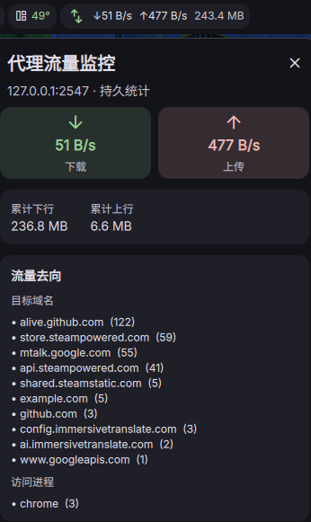
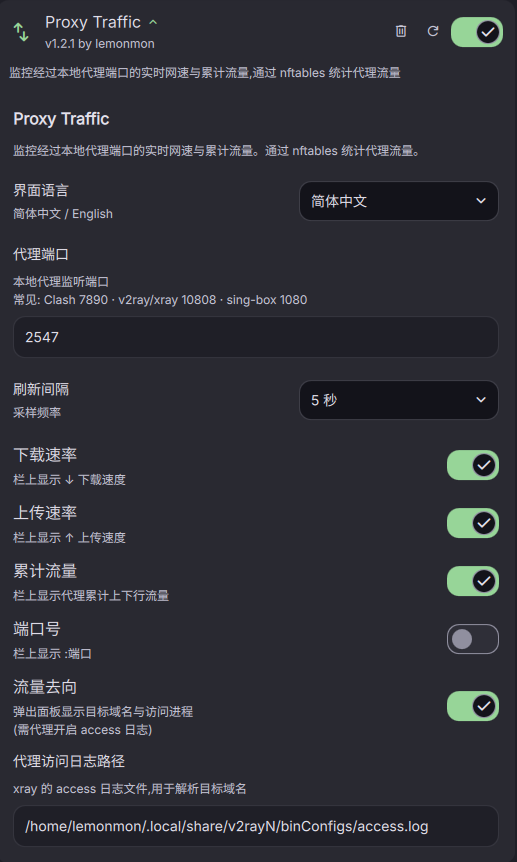

# Proxy Traffic — DMS 插件

**简体中文 · [English](README.md)**

一个针对 [DankMaterialShell](https://github.com/AvengeMedia/DankMaterialShell) 的 DankBar 组件，通过 **nftables** 计数器实时监控本地代理的网速与累计流量。

## 特性

- **栏上胶囊** — 实时代理下载/上传速度（`↓1.2 MB/s ↑45 KB/s`）
- **弹出面板** — 点击胶囊查看多张卡片：实时速率、累计流量、历史流量、流量去向、分流统计
- **模块化卡片** — 每张卡片（速度 / 累计流量 / 历史流量 / 流量去向 / 分流统计）可独立开关显示，并可在设置中**调整顺序**（上移/下移）
- **历史流量卡片** — 今天上下行流量（重启后保持），并带最近 N 天（3/7/14/30/90）的**折线图**：代理/直连两条线使用主题强调色，鼠标悬停某天节点会弹出 tooltip，显示当天代理/直连各自的上下行
- **今日流量卡片** — 实时显示今日 **Proxy**（代理）与 **Direct**（直连）的流量累计（上下行相加），使用主题强调色/成功色
- **订阅流量（可选）** — 填入 HTTP(S) 订阅链接后，今日流量卡片优先显示订阅已用 / 总计；若服务商只在节点名称中提供剩余流量，则显示剩余流量和到期时间
- **应用用量（可选）** — 流量去向卡片按应用显示今日代理用量；通过 `ss` 采样本地 TCP socket 计数，连接关闭后仍保留当天数据（近似值，最多可能少计最后一次采样前约 2 秒）
- **跨重启持久化** — 累计流量与逐日历史都会持久化到插件状态，即使 nftables 计数器在开机时归零也能保留
- **仅统计代理** — 只统计经过本地代理端口的流量
- **分流统计（xray）** — 可选的按出口统计，从 xray 的 `/debug/vars` 读取代理/直连各自的累计字节；今日卡与历史折线图也依赖该数据
- **可配置显示**：在栏上切换 下载速率 / 上传速率 / 累计流量 / 端口号
- 可调刷新间隔（1–5 秒）
- 中英双语界面
- 同时支持横向和纵向工具栏

## 安装

将本目录克隆（或复制）到 DMS 插件目录：

```bash
git clone https://github.com/Lemon-mon-254/dms-proxy-traffic.git ~/.config/DankMaterialShell/plugins/ProxyTraffic
```

然后在 DMS 中：**设置 → 插件 → 扫描插件**，启用 **Proxy Traffic**，将其添加到 DankBar 布局并重启：

```bash
dms restart
```

## 快速开始

运行一键安装命令。它会：检测/安装 `nft`（如缺失）、为你代理端口创建 nftables 计数器、将其**开机持久化**，并且只授予读取两条计数器链的无密码权限：

```bash
cd ~/.config/DankMaterialShell/plugins/ProxyTraffic
sudo ./setup-nftables.sh install
```

如果你的代理监听在非默认端口，用 `PROXY_PORT` 指定：

```bash
PROXY_PORT=2547 sudo ./setup-nftables.sh install
```

常见代理端口：**Clash 7890** · v2ray/xray 10808 · sing-box 1080。

`install` 一次完成下面几步（也可单独使用）：
- 检测并安装 `nft`（`nftables`）
- 为你的端口生成规则文件 `/etc/nftables.d/proxy-traffic.nft`
- 立即应用计数器
- 启用 systemd 服务（`nft-proxy-traffic.service`），开机自动加载
- 写入 `/etc/sudoers.d/proxy-nft`，仅允许 `nft list chain inet proxy_stat input` 和 `... output`，让组件无密码读取计数器但无法修改防火墙

> **从 1.5.0 或更早版本升级：** 请重新运行一次 `sudo ./setup-nftables.sh sudoers`（或 `install`），以替换旧的无限制 sudoers 规则。

> **注意：** 重新运行 `install`（或 `create`）会把计数器清零。请把插件中的"代理端口"设置为与本次相同。

## 配置项

| 设置 | 默认值 | 说明 |
|---|---|---|
| 代理端口 | `7890` | 本地代理监听端口（须与创建 nftables 规则所用的端口一致；常见：Clash `7890` · v2ray/xray `10808` · sing-box `1080`） |
| 刷新间隔 | `2s` | 采样频率 |
| 下载速率 | 开 | 栏上显示 `↓ 速度` |
| 上传速率 | 开 | 栏上显示 `↑ 速度` |
| 累计流量 | 关 | 栏上显示代理累计上下行流量 |
| 端口号 | 关 | 追加显示 `:端口` |
| 流量去向 | 关 | 弹出面板显示目标域名、访问应用及今日用量（域名需代理开启 access 日志；应用用量为 TCP 近似值） |
| 分流统计（xray） | 关 | 弹出面板显示 xray 出站的代理/直连累计字节 |
| **累计流量改用 xray** | 关 | 累计流量改用 xray（`/debug/vars`）而非 nftables，从而跨重启持续累计。仅对 xray/v2rayN 生效 |
| **栏上累计仅代理** | 关 | 栏上显示累计流量时只显示代理部分。需开启"累计流量改用 xray" |
| **速度卡片** | 开 | 弹出面板实时下载/上传速率卡片 |
| **累计流量卡片** | 开 | 弹出面板累计上下行流量卡片 |
| **历史流量卡片** | 开 | 弹出面板今日流量及折线图卡片 |
| 折线图天数 | `7` | 折线图显示最近多少天的历史（3/7/14/30/90） |
| 订阅链接 | 空 | 可选；今日流量卡片显示订阅已用 / 总计（若服务商只提供剩余流量，则显示剩余 / 到期）；链接含 token，请勿分享 |
| **顺序** | — | 调整弹出面板各卡片顺序（每卡上移/下移） |
| xray API 端口 | `2551` | xray API inbound 端口，用于分流视图及 xray 历史数据 |
| xray access 日志 | 空 | 可选，仅供"流量去向"卡片解析目标域名；留空则关闭 |

> **重要：** 设置中的"代理端口"应与运行 `setup-nftables.sh install` 时的端口一致，否则计数器将不匹配。

> xray 采样仅在启用**分流统计**、**历史流量卡片**或**累计流量改用 xray**时运行。

## 分流统计（仅 xray，可选）

启用后，弹出面板会按 xray 的每个出站（`proxy` vs `direct`）显示流出了多少流量，数据来自 xray 内置的 expvar 端点：

```bash
http://127.0.0.1:<xray-api-port>/debug/vars   # -> .stats.outbound.{proxy,direct}.{downlink,uplink}
```

- 需要 xray/v2rayN 已开启出站流量统计（`policy.system.statsOutboundUplink/Downlink`，v2rayN 默认开启），且存在 API inbound（默认 `2551`）。
- 该视图无需 nftables 规则；是对 nftables 计数器的补充（而非替代）。
- 端口不可达时，弹出面板会显示"xray 统计不可用"提示，不会报错。
- 除分流卡片外，**今日流量卡片**和**历史折线图**（代理 vs 直连逐日）也依赖 xray 数据——这两处始终用 xray 来区分代理/直连，因此要让图表有数据，代理 API 需可达。

## 订阅流量（可选）

在设置中填入 HTTP(S) 订阅链接后，插件每 30 分钟读取一次，并在**今日流量卡片**显示订阅流量。

如果服务商返回 v2rayN / Clash 常用的响应头：

```
已用 12.3 GB / 100 GB
```

- 支持 `subscription-userinfo` 格式（`upload` / `download` / `total` / `expire`，单位字节）。
- `total=0` 显示为“不限量”。
- helper 会以 Clash 客户端身份请求，因为部分服务商只对 Clash 客户端返回 `subscription-userinfo`。

有些服务商返回 base64 节点列表，不返回该响应头，而是把信息写在节点名称里，例如：

```
剩余流量：1.25 TB
套餐到期：长期有效
```

此时卡片显示：

```
订阅剩余 1.25 TB · 长期有效
```

- 这种非标准格式只提供剩余流量和到期时间，不提供套餐总量，因此无法计算已用 / 总计。
- 两种信息都没有时，卡片显示“订阅读取失败”。
- 订阅链接包含 token，只保存在 DMS 插件设置中，不会写入插件状态或日志；请勿截图分享。

## 应用用量（可选）

开启“流量去向”卡片后，卡片会按应用显示当天经过代理的 TCP 用量。首次开启或插件重启后从当时开始累计，不能回溯开启前的流量。

- 每次刷新（默认 2 秒）采样一次本机到代理端口的 TCP socket 计数，并按应用累加；应用关闭后当天用量仍保留。
- 只统计 TCP，不包含 UDP 和直连流量；连接关闭时最多可能少计最后一次采样前约 2 秒的数据，因此是近似值。
- 需要能看到应用进程的 socket 信息（同一用户运行的应用通常可以）。
- 状态保存在 `$XDG_STATE_HOME/dms-proxy-traffic/app-usage.json`（默认 `~/.local/state/dms-proxy-traffic/app-usage.json`），按本地日期自动重置。
- 目标域名仍来自 xray access 日志；没有日志时只显示应用用量。

## 规则管理

```bash
sudo ./setup-nftables.sh show          # 查看当前计数器与服务状态
sudo ./setup-nftables.sh create        # 重新创建/应用计数器（累计清零）
sudo ./setup-nftables.sh delete        # 删除运行时计数器（累计清零）
sudo ./setup-nftables.sh uninstall     # 移除计数器 + 持久化服务（可选移除免密）
```

计数器是**持久**的（由 systemd 服务在开机时重新加载），因此插件会显示自创建以来、跨重启累计的历史流量。

## 运行原理

随附的 `proxy-traffic-split` 脚本读取 nftables 计数器并输出一行 JSON：

```json
{"up": 118045, "down": 454352, "persistent": true}
```

- `up` — 发送到本地代理端口的字节数（应用 → 代理）
- `down` — 从本地代理端口接收的字节数（代理 → 应用）

QML 组件对连续采样做差分运算，从而得到实时速率。

## 屏幕截图





## 环境要求

- DankMaterialShell >= 1.4.0
- `nft`（nftables）、`sudo`
- `ss`（iproute2），用于"流量去向"卡片
- 一个监听在已配置端口上的本地代理（例如 v2ray/xray/sing-box/clash）
- xray 相关视图（分流、今日/历史）可选依赖：`curl` + `jq`，以及 xray/v2rayN 代理

## 许可证

MIT
